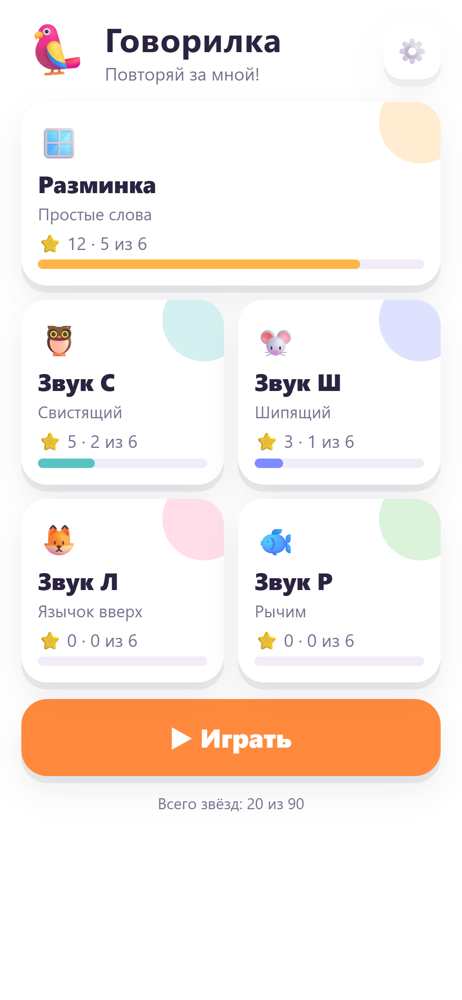
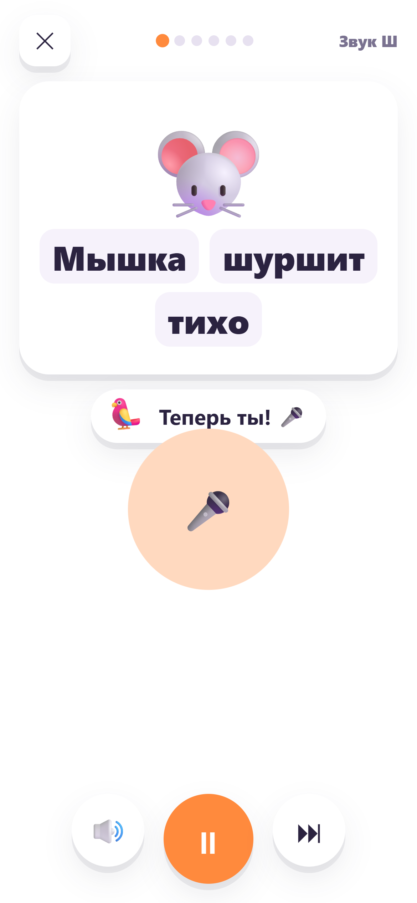
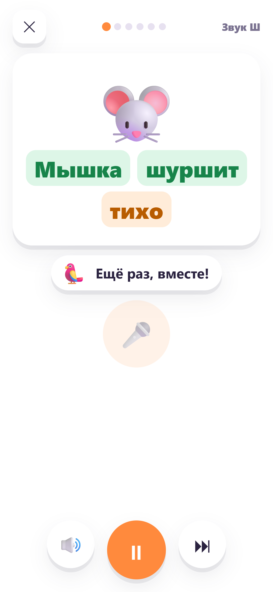
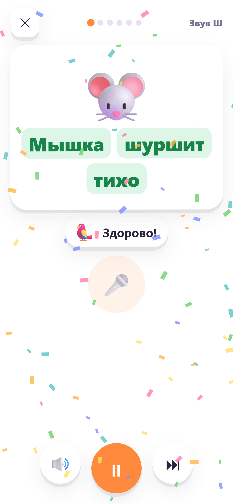

# Говорилка — логопедический тренажёр для детей (Android)

Ребёнок слушает короткую фразу и повторяет её. Приложение само проводит цикл: **говорит → слушает → оценивает → хвалит (конфетти и фанфары) или мягко просит повторить → следующая фраза**. В приложении 30 фраз по три слова, разбитых по звукам: разминка, С, Ш, Л, Р. Ставится из APK, Google Play не нужен.

| Главный экран | Ребёнок говорит | «Почти! Ещё раз» | Получилось! |
|---|---|---|---|
|  |  |  |  |

**[⬇ Скачать APK](https://github.com/NNKondratenko/govorilka/releases/latest)** · попробовать в браузере: `npm run serve` → `http://localhost:8095/?demo`

## Задача (из заказа)

> Есть прототип детского логопедического приложения на HTML/CSS/JS: упражнения, 30 фраз из трёх слов, озвучивание, распознавание речи, сравнение с образцом, похвала и конфетти. Нужно: собрать APK без Google Play; естественная русская озвучка с правильными ударениями, желательно женским голосом; автоматический цикл «произносит → слушает → оценивает → хвалит или просит повторить»; праздничный звук и анимация при успехе; разрешение на микрофон один раз; по возможности работа без интернета; передать APK и исходники.

## Как решено

| Требование | Решение |
|---|---|
| APK без Google Play | Нативная оболочка на Kotlin, веб-часть внутри APK (158 КБ). Подпись постоянным ключом: новая версия ставится поверх старой, прогресс ребёнка сохраняется. CI собирает APK на каждый коммит. |
| Озвучка с ударениями | Ударения размечены в каждой фразе (`М+ама м+ыла р+аму`). В синтезатор они уходят знаком ударения U+0301, который учитывает движок Google. Голос и скорость выбираются в настройках, по умолчанию берётся голос без интернета и речь чуть медленнее, для детей. |
| Естественный голос | **«Свой голос»**: родитель или логопед один раз записывает фразы в приложении, дальше звучат записи, а синтезатор не используется. Живая интонация и верные ударения, работает офлайн. |
| Автоцикл | Модуль `cycle.js`: говорит, слушает, оценивает. Не услышало — просит сказать громче. Почти верно — повторить. После 3 попыток (настраивается) мягко переходит к следующей фразе. |
| Оценка ответа | Распознаватель отдаёт до 5 вариантов, проверяются все. Сравнение пословное, порядок слов не важен, допустимые оговорки зависят от строгости («лыба» вместо «рыба» засчитывается в мягком режиме). Слова подсвечиваются: зелёное — сказал, оранжевое — пропустил. |
| Праздник при успехе | Конфетти на canvas и фанфары, синтезированные Web Audio: без звуковых файлов, работают офлайн. Похвала голосом: «Молодец!», «Умница!». |
| Микрофон один раз | WebView не запрашивает микрофон: распознавание нативное (`SpeechRecognizer`). Системное разрешение спрашивается один раз, после короткого объяснения для родителя. Если его запретили навсегда, кнопка ведёт в настройки. |
| Без интернета | Весь интерфейс внутри APK. На Android 12+ сначала используется **распознавание на устройстве**, иначе — с флагом «предпочитать офлайн». Озвучка идёт через офлайн-голос или записи. |
| Код и APK | Этот репозиторий; APK лежит в Releases. |

**Почему не просто «обернуть HTML в WebView»:** в Android WebView не работают Web Speech API (`speechSynthesis` молчит, `SpeechRecognition` отсутствует). Поэтому синтез, распознавание и запись сделаны нативно, а веб-часть обращается к ним через мост `GovorilkaNative`. Тот же веб-код в браузере работает через Web Speech API: так удобно разрабатывать и показывать.

## Для родителей

Настройки открываются **долгим нажатием на ⚙️**, чтобы ребёнок не попал туда случайно. В них:
- голос и скорость речи;
- строгость проверки и число попыток;
- автопереход к следующей фразе и показ ударений;
- запись своего голоса для каждой фразы;
- сброс звёзд.

Звёзды: 3 за успех с первой попытки, 2 со второй, 1 позже.

## Устройство

```
web/                    интерфейс и логика (ES-модули, без фреймворков и сборки)
  phrases.js            30 фраз с ударениями, группы по звукам, похвала
  match.js              нормализация, расстояние Левенштейна, пословная оценка
  cycle.js              автоцикл, не зависит от платформы (тестируется в Node)
  speech.js             Android-мост · Web Speech API · демо-режим
  celebrate.js          конфетти и фанфары
app/                    Android (Kotlin, без Compose): MainActivity + WebViewAssetLoader
  NativeBridge.kt       JS ↔ Android: speak / listen / record / permission
  Speaker.kt            TextToSpeech, русский голос, ударения
  Listener.kt           SpeechRecognizer: on-device → обычный, до 5 вариантов
  Recorder.kt           запись своего голоса (AAC) и воспроизведение
scripts/emulator-smoke.sh  проверка на эмуляторе Android в CI
```

## Сборка и проверка

```bash
npm test                      # логика: фразы, сравнение, автоцикл (Node 22)
./gradlew assembleRelease     # APK: app/build/outputs/apk/release/app-release.apk (JDK 21, Android SDK)
```

На каждый коммит CI делает три вещи:
1. прогоняет тесты логики и юнит-тесты Kotlin;
2. собирает подписанный APK;
3. **ставит его на эмулятор Android 14** и проходит путь первого запуска: объяснение и системный запрос микрофона, главный экран, старт упражнения, перезапуск без повторного запроса. По дороге делает скриншоты и падает на ошибках JavaScript и крэшах.

APK из тега `v*` публикуется в Releases.

## Лицензия

MIT
